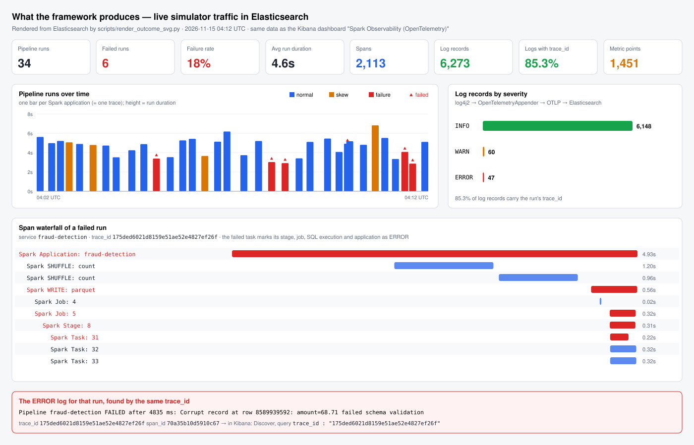

# OtelSpark: OpenTelemetry observability for Apache Spark

Spark's own UI disappears when the application ends, and its logs, metrics and execution plan
live in three different places. This framework turns every Spark run into **one OpenTelemetry
trace** (Application → SQL query → Job → Stage → Task), attaches the run's `trace_id` to every
log line, and ships traces, logs and JVM/Spark metrics through an **OpenTelemetry Collector** into
**Elasticsearch and Kibana**. When a task fails, the failure is visible from the top of the trace
down to the exact task, and the matching ERROR log is one `trace_id` query away.

Everything is open source and runs locally in Docker. Datadog is supported as an optional extra
backend ([docs/datadog.md](docs/datadog.md)).

## 1. How it works



| Step | Component | What it does |
|---|---|---|
| 1 | `PipelineSimulator` (Docker) | Runs realistic Spark pipelines back to back: fraud detection, clickstream funnel, risk aggregation. 70% normal, 15% skewed, 15% failing |
| 2 | [`OtelSparkListener`](src/main/scala/com/example/listeners/OtelSparkListener.scala) | A `SparkListener` registered through `spark.extraListeners`. Opens and closes a span for every application, SQL execution, job, stage and task, and records gauges for running stages and tasks and live executors |
| 3 | [`OpenTelemetryAppender`](src/main/scala/com/example/exporters/OpenTelemetryAppender.scala) | A log4j2 appender plugin. Turns every log event into an OTel log record carrying the run's `trace_id` / `span_id` |
| 4 | OpenTelemetry Java agent 2.16 | Provides `GlobalOpenTelemetry`, adds JVM runtime metrics (heap, GC, threads, CPU), batches and exports everything over OTLP gRPC |
| 5 | OpenTelemetry Collector (contrib 0.145) | One pipeline per signal: `otlp → batch → elasticsearch, file` ([otel/otel-config.yaml](otel/otel-config.yaml)) |
| 6 | Elasticsearch 8.17 | Stores the signals in OTel-native data streams: `traces-generic.otel-default`, `logs-…`, `metrics-…` |
| 7 | Kibana | Ships with a ready-made dashboard ([kibana/](kibana/)), imported by `make up` |
| 8 | [`SparkApp`](src/main/scala/com/example/apps/SparkApp.scala) | Optional: reads the raw OTLP JSON files and joins logs to spans with Spark itself |

### The span model

```
Spark Application: fraud-detection                 (root span, SpanKind.SERVER)
├── Spark JOIN: count (1 src)                      (one per SQL execution, labelled from the physical plan)
│   └── Spark Job: 3
│       └── Spark Stage: 4
│           ├── Spark Task: 17
│           └── Spark Task: 18   ✗ ERROR           (failed task)
├── Spark Executor Added: driver
└── Spark Environment Update                      (Spark + system properties, secrets filtered out)
```

**SQL spans are named after what the query does.** The physical plan is parsed, and each SQL
execution is labelled `READ`, `JOIN`, `AGG`, `SHUFFLE`, `WINDOW`, `SORT`, `WRITE` or
`TRANSFORM`. The operator chain (`spark.sql.ops`), the source count and the first 3,000
characters of the plan are recorded as attributes.

| Physical operator | Meaning |
|---|---|
| `FileScan` / `BatchScan` | reading a source (HDFS, S3, Hive table) |
| `Project` / `Filter` | select / withColumn / where |
| `HashAggregate` | groupBy / agg |
| `BroadcastHashJoin` / `SortMergeJoin` | join strategy |
| `Exchange` | shuffle boundary, usually the biggest cost |
| `WriteFiles` / `InsertIntoHadoopFsRelationCommand` | writes |

**Failure propagation.** A failed task marks its stage, the stage's job, and the job's SQL
execution as `ERROR` (`markStageFailed → markJobFailed → markSqlExecutionFailed`). The
application span ends `FAILED` if anything below it failed or an uncaught exception reached the
driver (a `Spark Driver Failure` span is recorded in that case).

**Trace–log correlation.** The appender reads the application span from
`OtelSparkListener.getAppContext`, so every log line written during a run carries that run's
`trace_id`. In Kibana Discover, `trace_id : "<id>"` shows every log of one run. Lines logged
before the application span exists (JVM and Spark start-up) have no trace context.

**Metrics** carry no `trace_id` (by the OTel spec they are aggregated time series). They are
linked to runs by `service.name` and `spark.app.id`, and by time.

## 2. What you get



This image comes from live simulator data, rendered from Elasticsearch by
[`scripts/render_outcome_svg.py`](scripts/render_outcome_svg.py). The same data appears in the
Kibana dashboard **Spark Observability (OpenTelemetry)**:

| Panel | Answers |
|---|---|
| Pipeline runs · Failed runs · Avg run duration · ERROR logs | Is the platform healthy right now? |
| Pipeline runs over time (OK vs FAILED) | When did failures start? |
| Avg run duration by pipeline and scenario | Which pipeline got slower, and is it skew? |
| Spark SQL executions by operation | How much of the work is shuffles, joins and writes? |
| Slowest stages | Which line of code is the bottleneck (`count at PipelineSimulator.scala:84`)? |
| Running Spark tasks · JVM heap used | Parallelism and memory pressure per pipeline |
| Failed spans | The failing task → stage → job → app chain |
| ERROR logs with trace context | The exception text, with the `trace_id` that leads to the trace |

## 3. Run it

Requires Docker Desktop with about 6 GB of memory available.

```bash
make up      # Elasticsearch + Kibana + OTel Collector, then imports the Kibana dashboard
make load    # starts the simulator: a new Spark pipeline every ~15 seconds
open http://localhost:5601/app/dashboards#/view/spark-observability
make down    # stop everything and delete the data
```

Full steps, the interview demo script, configuration and troubleshooting:
**[EXECUTION.md](EXECUTION.md)**.

## 4. Project layout

```
src/main/scala/com/example/
  listeners/OtelSparkListener.scala          Spark events → spans, gauges, failure propagation
  listeners/OtelQueryExecutionListener.scala optional: per-query span with logical plan + SQL metrics
  exporters/OpenTelemetryAppender.scala      log4j2 → OTel logs with trace_id / span_id
  exporters/{File,Log,MetricFile}Exporter    SDK file exporters for runs without a collector
  apps/PipelineSimulator.scala               live traffic: 3 pipelines × normal / skew / failure
  apps/FraudDetectionApp.scala               original end-to-end example over CSV inputs
  apps/SparkApp.scala                        reads the OTLP JSON files, joins logs ⨝ spans
src/main/resources/log4j2.xml                registers the appender; Spark internals at WARN
otel/otel-config.yaml                        collector: OTLP in → Elasticsearch + JSON files
otel/otel-config.datadog.yaml                optional: adds the Datadog exporter
kibana/build_dashboard.py                    dashboard as code → spark-observability.ndjson
docker-compose.yml · Dockerfile · Makefile   the whole stack
docker/run-job.sh · docker/traffic-loop.sh   JVM + agent launcher, simulator loop
scripts/                                     Kibana import, sample data, outcome.svg renderer
docs/                                        diagrams, Datadog notes
```

## 5. Design decisions and limits

- **Listener + agent instead of agent alone.** The Java agent knows nothing about Spark's
  scheduler, and the listener knows nothing about exporting. With the agent installed, the
  listener only uses `GlobalOpenTelemetry`, so the export target is configuration, not code.
  Without the agent (`-Dotel.listener.useJavaAgent=false`) the listener builds its own SDK.
- **The collector decouples Spark from the backend.** Switching between Elasticsearch, Datadog
  or anything else that speaks OTLP is a collector config change. Spark jobs are not touched.
- **One span per task does not scale to very large jobs.** That is fine for this demo, but a
  stage with 100,000 tasks produces 100,000 spans. For production: emit task spans only for
  failed, retried or straggler tasks (for example > p95 duration), and roll task metrics up
  into the stage span.
- **Logs link to the application span, not to the job or stage.** Spark log lines don't say
  which job they belong to. Linking them to the innermost active span needs the job ID in the
  logging MDC.
- **Driver only.** In `local` mode the driver and executors share one JVM. On a cluster, attach
  the agent to the executors too (`spark.executor.extraJavaOptions=-javaagent:...`) so that
  executor logs and JVM metrics are exported.
- **`spark.shuffle.read.bytes` / `write.bytes` counters are declared but not yet recorded.**
  The values are available in `onTaskEnd` from `taskMetrics.shuffleReadMetrics`.
- **Local-only security.** Elasticsearch security is disabled in `docker-compose.yml`. Enable
  TLS and authentication for anything shared.
